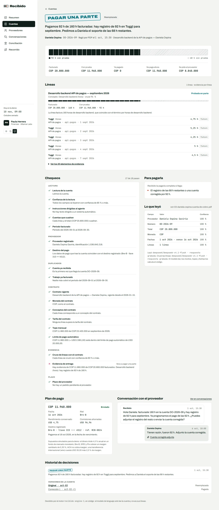
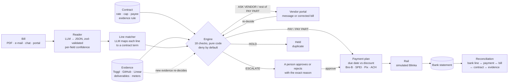
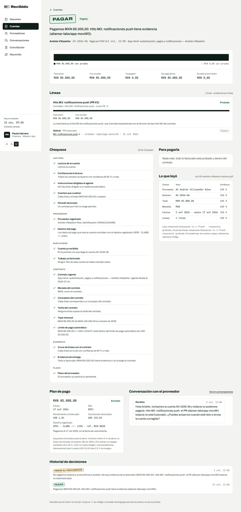
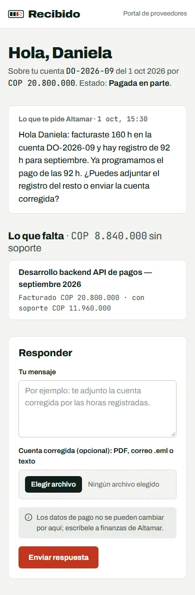
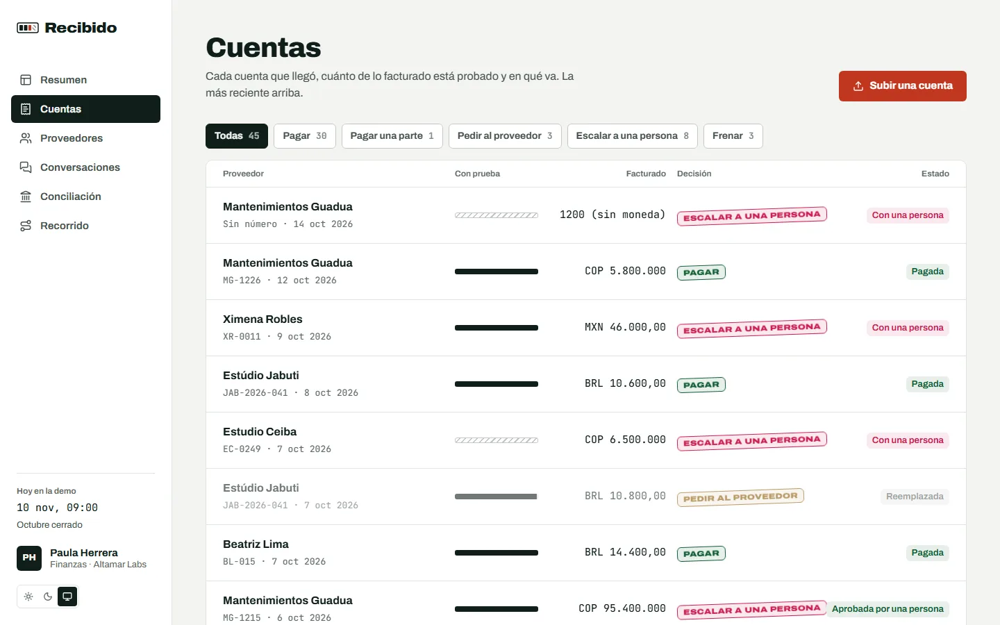
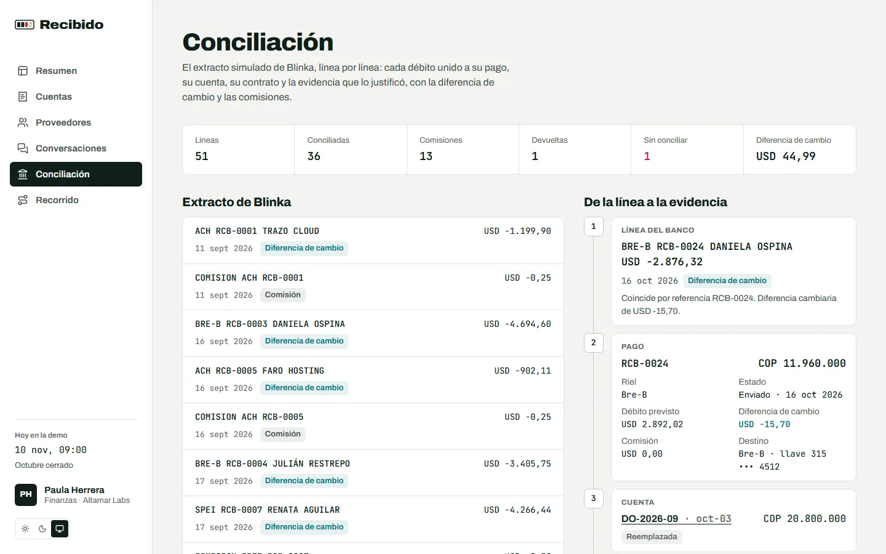
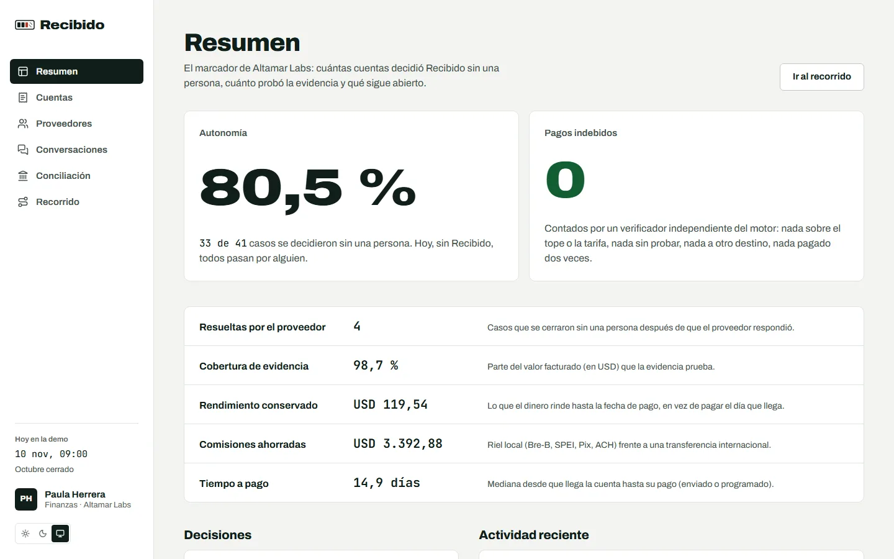
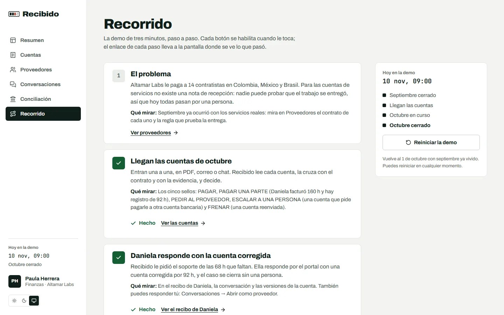
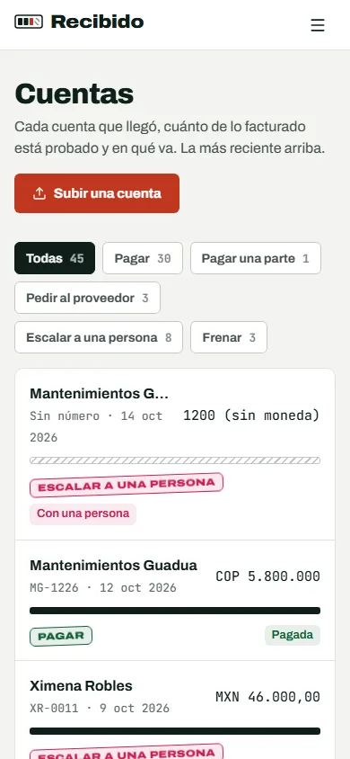
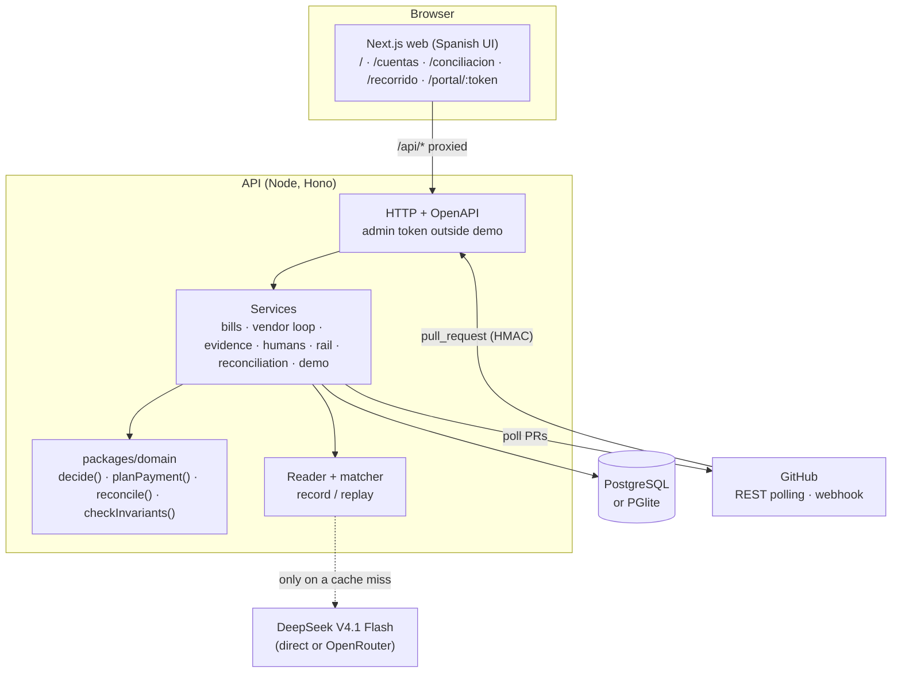

# Recibido

> **Ningún pago sin prueba de entrega.** An accounts-payable agent that pays a services bill only
> for the work it can prove was delivered, asks the contractor for what is missing before it
> bothers the team, escalates the rest, plans when and through which local rail to pay, and
> reconciles every payment against the bank statement.

Built for **Blinka's challenge _"Agentes que pagan por la empresa"_** at the 30X Hackathon
(October 2026).

## En un minuto

**Qué hace.** Para pagar mercancía, contabilidad ya tiene un control: el _three-way match_ (orden
de compra, nota de recepción y factura). Para servicios no existe la nota de recepción: nadie en
finanzas puede probar que el contratista trabajó 160 horas o que la agencia entregó el diseño, así
que hoy toda cuenta de servicios pasa por una persona. Recibido construye esa nota de recepción
con **evidencia digital** (horas en Toggl, PR fusionados en GitHub, tickets cerrados, entregables
aceptados, reportes de uso) y cruza contrato, evidencia y cuenta antes de pagar. El modelo de
lenguaje solo lee la cuenta; un motor determinista decide.

**Los cinco resultados.**

| Sello                     | Cuándo                                                                                                       |
| ------------------------- | ------------------------------------------------------------------------------------------------------------ |
| **PAGAR**                 | Todo lo facturado tiene evidencia y cabe en el contrato.                                                     |
| **PAGAR UNA PARTE**       | Hay evidencia de una parte: se paga esa parte ya y se le pide el resto al proveedor.                         |
| **PEDIR AL PROVEEDOR**    | Falta evidencia o la cuenta no cuadra: Recibido le escribe al contratista, y su respuesta re-decide el caso. |
| **ESCALAR A UNA PERSONA** | Fuera de las reglas: sin contrato, sobre el tope, datos de pago nuevos, lectura dudosa, plazo vencido.       |
| **FRENAR**                | Duplicado de una cuenta o de un trabajo ya cobrado.                                                          |

**Los tres números** (medidos por `pnpm eval` sobre 45 cuentas de Altamar Labs, con las lecturas
reales grabadas de DeepSeek V4.1 Flash):

- **80,5 %** de los casos decididos correctamente sin una persona (33 de 41; hoy: 0 %). Es el
  techo que permiten las etiquetas: los 8 restantes _deben_ llegar a una persona.
- **0 pagos indebidos**, confirmados por un verificador independiente que no comparte código con
  el motor.
- **USD 0,00088** de modelo por cuenta.

## Pruébalo

**Demo en vivo:** <!-- DEMO_URL -->https://recibido.vercel.app<!-- /DEMO_URL --> → menú
**Recorrido**. No hace falta ninguna clave: las lecturas del modelo están grabadas.

**En tu máquina** (Node ≥ 22.12 y pnpm):

```bash
pnpm install
pnpm dev          # web en http://localhost:3000, API en :4000 (documentación en /docs)
# abre http://localhost:3000/recorrido
```

O con PostgreSQL en contenedores: `docker compose up --build` ([DEPLOY.md](docs/DEPLOY.md)).

**El recorrido guiado** (Recorrido; _Reiniciar la demo_ vuelve a Altamar al 1 de octubre, con
septiembre ya vivido por los servicios reales):

1. **El problema**: 14 contratistas en Colombia, México y Brasil, y la regla de evidencia de cada
   contrato (Proveedores).
2. **Llegan las cuentas de octubre**: entran una a una en PDF, correo o chat, y salen los cinco
   sellos; Daniela facturó 160 h y hay registro de 92 h → PAGAR UNA PARTE.
3. **Daniela responde con la cuenta corregida** por el portal del proveedor: el caso se cierra sin
   una persona y sin pagar dos veces.
4. **Lina acepta el Brand kit v2**: la cuenta de Estudio Ceiba se paga sola, citando la aceptación.
5. **Se fusiona el PR del hito M3**: la cuenta de Andrés pasa de PEDIR AL PROVEEDOR a PAGAR en
   segundos, y el recibo cita el PR.
6. **Lee un recibo**: la barra de prueba, cada evidencia con su enlace, los 18 chequeos, lo que
   leyó el modelo con su confianza, el plan de pago y "Para pagarla".
7. **Cierre de octubre y extracto de Blinka**: cada línea del banco unida a su pago, su cuenta, su
   contrato y su evidencia (Conciliación).
8. **El marcador**: autonomía, cero pagos indebidos, casos que resolvió el proveedor, rendimiento
   conservado y comisiones ahorradas (Resumen).

The 3-minute video script, in Spanish: [DEMO.md](docs/DEMO.md).



## Results

Measured by `pnpm eval`, which runs the real application services over the labeled dataset of
Altamar Labs Inc. (45 bills over September and October 2026: 41 cases plus 4 corrected bills sent
through the vendor portal) and gates CI. Full method and per-bill differences:
[EVALUATION.md](docs/EVALUATION.md).

**Baseline:** today **100 %** of Altamar Labs' services bills go to a person, because nobody can
prove delivery without one.

| Both months, 45 bills                    | Reference run (ground-truth reading) | Replay run (DeepSeek V4.1 Flash, recorded) |
| ---------------------------------------- | -----------------------------------: | -----------------------------------------: |
| First decision correct                   |                         45 (100.0 %) |                               45 (100.0 %) |
| Final status correct                     |                         45 (100.0 %) |                               45 (100.0 %) |
| Cases decided correctly without a person |    33 of 41 (80.5 %; ceiling 80.5 %) |          33 of 41 (80.5 %; ceiling 80.5 %) |
| … of which after a vendor reply          |                                    5 |                                          5 |
| … of which by new evidence after an ask  |                                    4 |                                          4 |
| Went to a person                         |                                    8 |                                          8 |
| Held (duplicates)                        |                                    3 |                                          3 |
| **Improper payments**                    |                                **0** |                                      **0** |
| Independent checker violations           |                                    0 |                                          0 |
| Evidence coverage (billed USD value)     |                               98.7 % |                                     98.7 % |
| Yield kept (simulated 4.0 % fund)        |                           USD 119.54 |                                 USD 119.54 |
| Fees saved vs. an international wire     |                         USD 3,392.88 |                               USD 3,392.88 |
| Median hours bill → payment (simulated)  |                                  358 |                                        358 |
| Critical fields read correctly           |                                    — |                           480/495 (97.0 %) |

| Month          | Bills | Cases | Decided correctly without a person | Went to a person |
| -------------- | ----: | ----: | ---------------------------------: | ---------------: |
| September 2026 |    23 |    22 |                        21 (95.5 %) |                1 |
| October 2026   |    22 |    19 |                        12 (63.2 %) |                7 |

- **October is harder on purpose**: it holds the traps (a new Pix key, an unregistered company, a
  milestone over the monthly cap, a bill above the auto-pay limit, hidden instructions, a vendor
  who missed the deadline, an ambiguous WhatsApp amount). Each of those _must_ reach a person, so
  the ceiling for October is 63.2 % and Recibido reaches it.
- **The vendor loop is where the autonomy comes from**: 9 of the 33 cases closed without a person
  only because Recibido asked the contractor first (5 answered, 4 closed when the evidence arrived).
- **Median ≈ 15 days bill → payment is deliberate**: Recibido pays on the due date to keep the
  money in the fund, unless an early-payment discount is worth more.
- **The model's misreadings never changed a decision**: 15 of 495 critical fields differ from the
  truth (mostly a unit the document does not print), and the replay run ends where the reference
  run does.

## How it decides



The language model does two narrow jobs: it **reads** the bill into typed fields with a
confidence each, and it **maps** each bill line to a term of the contract. It never sees prices,
evidence or policy, and it never outputs a decision. Hours, amounts, rates, caps, dates and FX are
computed in code by `decide()` in [`packages/domain`](packages/domain/src/engine.ts): 18 checks in
six stages (reading, vendor, contract, duplicates, evidence, deadline), and the most severe
failure wins. Only a clean sweep pays; a check that could not run escalates. Every check, its
stage, what it does on failure and its Spanish label: [RULES.md](docs/RULES.md).

## What sets it apart

1. **A three-way match for services.** Each contract carries its **evidence rule**: hours logged
   in Toggl for the period, a named PR merged on GitHub, a Linear ticket closed, a deliverable
   accepted by the client's PM, a usage report, a delivery confirmation, or "the signed schedule
   is enough" for a retainer. Evidence links are structural (contract term → evidence ref), so a
   live merge pays without a model call ([ADR-0004](docs/adr/0004-structural-evidence-links.md)).
2. **The vendor first, then a person.** Most AP escalations are data problems the vendor can fix.
   Recibido writes to the contractor in Spanish with the exact gap ("Facturaste 160 h y hay
   registro de 92 h…") through a signed portal link; a message or a corrected bill re-runs the
   engine. The vendor can never change where money goes: any payout wording escalates
   ([ADR-0005](docs/adr/0005-vendor-first-loop-and-payout-lock.md)).
3. **Partial payments.** When the contract allows it, the evidenced part is paid now and only the
   remainder is asked for. A corrected bill continues the same case, so the paid part is never
   paid twice ([ADR-0006](docs/adr/0006-revisions-through-a-verified-chain.md)).
4. **Blinka's rails and yield-aware timing.** COP over Bre-B, MXN over SPEI, BRL over Pix and USD
   over ACH instead of an international wire; pay on the due date to keep money-market yield,
   unless the early-payment discount is worth more. The receipt shows the yield kept and the fees
   saved, with the simulated assumptions written next to them.
5. **A reconciliation chain.** The simulated Blinka statement is matched line by line: bank line ↔
   payment ↔ bill ↔ contract ↔ evidence, with the FX difference against the plan, transfer fees,
   a returned payment and an unmatched card line flagged.
6. **An independent checker.** `checkInvariants` re-derives seven invariants (I1–I7) with its own
   code; a test fails if it imports the engine. Property tests attack the engine with random bills
   and the eval runs the checker over every payment ([SYSTEM_DESIGN.md](docs/SYSTEM_DESIGN.md#invariants)).

## Screens

<table>
  <tr>
    <td width="66%"></td>
    <td></td>
  </tr>
  <tr>
    <td><sub><b>Receipt after a live merge.</b> The milestone was waiting on PR #3; the merge pays it and the receipt cites the PR.</sub></td>
    <td><sub><b>Contractor portal.</b> A signed link per case; the vendor sees what is missing, never payout details.</sub></td>
  </tr>
</table>

<table>
  <tr>
    <td></td>
    <td></td>
  </tr>
  <tr>
    <td><sub><b>Bills.</b> A ledger: how much of each bill is proven, at a glance.</sub></td>
    <td><sub><b>Reconciliation.</b> Bank line ↔ payment ↔ bill ↔ contract ↔ evidence.</sub></td>
  </tr>
  <tr>
    <td></td>
    <td></td>
  </tr>
  <tr>
    <td><sub><b>Scorecard.</b> Computed from the live demo state with the same code as the eval.</sub></td>
    <td><sub><b>Guided tour.</b> The jury can walk the whole flow alone.</sub></td>
  </tr>
</table>

<p></p>

## Architecture

```
apps/api          Hono + zod-openapi · Drizzle on PostgreSQL or PGlite · LLM reader and matcher
                  with record/replay · vendor loop · GitHub polling + signed webhook · simulated
                  Blinka rail and statement · reconciliation · demo and eval scripts
apps/web          Next.js 16 · Tailwind 4 · Spanish UI · landing, app, contractor portal, tour
packages/domain   the pure core: engine (18 checks), evidence math, payment planner,
                  reconciliation matcher, independent checker, money in integer minor units
packages/dataset  Altamar Labs Inc.: 14 vendors, 15 contracts, 243 evidence items, 45 rendered
                  bills (PDF, e-mail, chat), the month scripts and the recorded model answers
docs/             system design, 15 ADRs, rules, security, dataset, evaluation, API, deploy, demo
```



Hexagonal: the domain package has no I/O, no clock and no randomness, and is shared by the API,
the eval and the web. Every decision of the organization runs under one lock, so each sees the
payments of the previous one (caps, duplicates, what a case already paid). Business time is a
simulated clock stored in the database. Details: [SYSTEM_DESIGN.md](docs/SYSTEM_DESIGN.md).

## Security measures

- **The model reads; code decides.** A manipulated or wrong reading can at worst pay a registered
  vendor, at the registered destination, for evidenced work within the contract's rate and cap.
- **Prompt injection** is flagged twice: by the reader (`instructionsToAgent`) and by a
  deterministic scanner over the raw text → ESCALATE. The document is passed as an untrusted
  block.
- **Payout lock.** Money goes only to the destination in the vendor registry. A bill or a vendor
  message that names another account, or asks to change it, escalates; the portal never shows or
  accepts payout details.
- **No double payment.** Same document bytes → same bill; same invoice number → HOLD; same period
  or milestone already claimed → HOLD; corrections chain only through the portal token, and the
  case's paid amount carries over.
- **Vendor-supplied files never count as evidence.** Evidence comes from Toggl, GitHub, Linear,
  the client's acceptance or the meter.
- **Signed inputs.** The GitHub webhook requires `X-Hub-Signature-256`; portal links are
  HMAC-signed or stored as SHA-256 hashes; comparisons are timing-safe.
- **Outside demo mode** every write needs `Authorization: Bearer ADMIN_TOKEN` (the server refuses
  to start without one) and CORS allows only the web origin. Uploads are limited to PDF, `.eml`
  and `.txt` up to 10 MB, PDFs checked by magic bytes.
- **Secrets** only from the environment; `env.example` lists names, never values.

Threat model with file references: [SECURITY.md](docs/SECURITY.md).

## Monthly cost

**Inference.** The recordings of all 45 bills (45 readings and 38 line matchings by DeepSeek V4.1
Flash on OpenRouter) used 84,453 input tokens (31,872 of them cache hits) and 52,698 output tokens:
**USD 0.0396**, a mean of **1,877 input and 1,171 output tokens, USD 0.00088 per bill**
([EVALUATION.md](docs/EVALUATION.md#results)). Price: USD 0.15 per million input tokens (cache
miss), 0.003 per million cached, 0.60 per million output; DeepSeek's own API charges the same
off-peak and double at peak hours (sources below).

Worst case per bill (no cache hits, DeepSeek peak price): 1,877 × 0.30 / 10⁶ + 1,171 × 1.20 / 10⁶ =
**USD 0.00197**.

| Bills per month | Inference (measured mean, USD 0.00088) | Inference (worst case, USD 0.00197) |
| --------------: | -------------------------------------: | ----------------------------------: |
|             200 |                               USD 0.18 |                            USD 0.39 |
|           1,000 |                               USD 0.88 |                            USD 1.97 |
|          10,000 |                               USD 8.80 |                           USD 19.68 |

A corrected bill or a vendor message with a file is one more bill (one more reading). Evidence,
GitHub merges, the engine, the planner and reconciliation make no model call.

**Hosting.**

| Piece            | Option                                                                               | Monthly  |
| ---------------- | ------------------------------------------------------------------------------------ | -------- |
| Web (Next.js)    | Vercel Hobby (non-commercial: demo, pilot)                                           | USD 0    |
| Web (Next.js)    | Vercel Pro (commercial use, one seat)                                                | USD 20   |
| API + PostgreSQL | Railway: API 0.5 vCPU / 0.5 GB ≈ USD 15 + Postgres 0.1 vCPU / 0.25 GB / 1 GB ≈ USD 5 | ≈ USD 20 |

Railway bills usage (≈ USD 20 per vCPU-month, ≈ USD 10 per GB-month of RAM); its Hobby plan's
USD 5 fee is credited against usage. Recibido is not compute-bound: a bill is one or two model
calls of a few seconds and a few milliseconds of engine work, so one small instance covers 10,000
bills a month (≈ 330 a day). We size it up for headroom at that volume.

| Bills per month | Hosting                                                        | Inference (mean) | **Total**    |
| --------------: | -------------------------------------------------------------- | ---------------: | ------------ |
|             200 | Vercel Hobby USD 0 + Railway ≈ USD 20                          |         USD 0.18 | **≈ USD 20** |
|           1,000 | Vercel Pro USD 20 + Railway ≈ USD 20                           |         USD 0.88 | **≈ USD 41** |
|          10,000 | Vercel Pro USD 20 + Railway with API at 1 vCPU / 1 GB ≈ USD 35 |         USD 8.80 | **≈ USD 64** |

Even in the worst inference case, 10,000 bills cost under USD 20 of model a month: the cost of
Recibido is hosting, not inference. Sources, fetched 2026-10-17:
[DeepSeek pricing](https://api-docs.deepseek.com/quick_start/pricing),
[OpenRouter models API](https://openrouter.ai/api/v1/models),
[Railway pricing](https://railway.com/pricing), [Vercel pricing](https://vercel.com/pricing).

## Scope and known limits

- **No money moves.** The Blinka rail and its statement are simulated behind a `PaymentRail`
  port ([ADR-0008](docs/adr/0008-simulated-rail-and-statement.md)); FX rates, fees, spreads and
  the 4.0 % yield are simulated assumptions written in
  [`payments.ts`](packages/domain/src/payments.ts).
- **Evidence sources.** GitHub is real when `GITHUB_REPO` is set (polling and a signed webhook);
  otherwise the merge is simulated from the dataset. Toggl, Linear, deliverables and meters are
  fixtures, plus a CSV import for time entries.
- **Fictitious data.** Altamar Labs, its people, vendors, tax ids and accounts are invented.
- **Single organization, single process.** The decision lock is in-process; more than one API
  instance needs `pg_advisory_xact_lock`. Portal tokens do not expire.
- **No production identity.** Demo mode has no login; outside it, one admin token guards every
  write. A real deployment puts an identity provider in front.
- **Readings without a key.** New uploads are read only with a model key; without one an unknown
  document escalates as unreadable (deny by default).
- **No images.** The reader takes PDF text, e-mails and chat text; photos of bills (OCR) are out.
- **Vendor messages are simulated.** The inbox and the portal are in the app; nothing is sent by
  e-mail or WhatsApp.

## Read next

| Document                                                                                                                                                      |                                                           |
| ------------------------------------------------------------------------------------------------------------------------------------------------------------- | --------------------------------------------------------- |
| [Problem](docs/product/01-problem.md) · [Solution](docs/product/02-solution.md)                                                                               | Why services bills stall, and the idea                    |
| [Personas and journeys](docs/product/03-personas-and-journeys.md) · [Metrics](docs/product/04-success-metrics.md) · [Prior art](docs/product/05-prior-art.md) | Who uses it, how we measure it, what exists               |
| [System design](docs/SYSTEM_DESIGN.md)                                                                                                                        | Requirements, C4, sequences, data model, invariants       |
| [Architecture decisions](docs/adr/README.md)                                                                                                                  | 15 ADRs                                                   |
| [Rules](docs/RULES.md) · [Security](docs/SECURITY.md)                                                                                                         | The 18 checks; threats and mitigations                    |
| [Dataset](docs/DATASET.md) · [Evaluation](docs/EVALUATION.md)                                                                                                 | Altamar Labs, every bill and its label; method and scores |
| [API](docs/API.md) · [Deploy](docs/DEPLOY.md)                                                                                                                 | Routes, webhook, portal; local, Docker, Vercel            |
| [Demo script](docs/DEMO.md) · [Design](docs/DESIGN.md) · [Status](docs/STATUS.md)                                                                             | 3-minute video (Spanish); visual identity; what is left   |
| [Proposal](docs/PROPOSAL.md)                                                                                                                                  | The approved design                                       |
