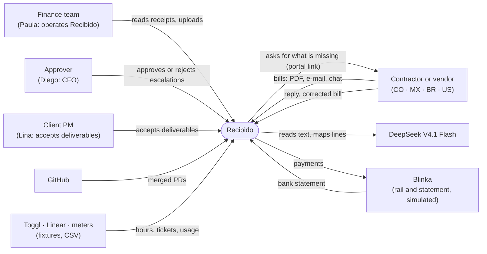
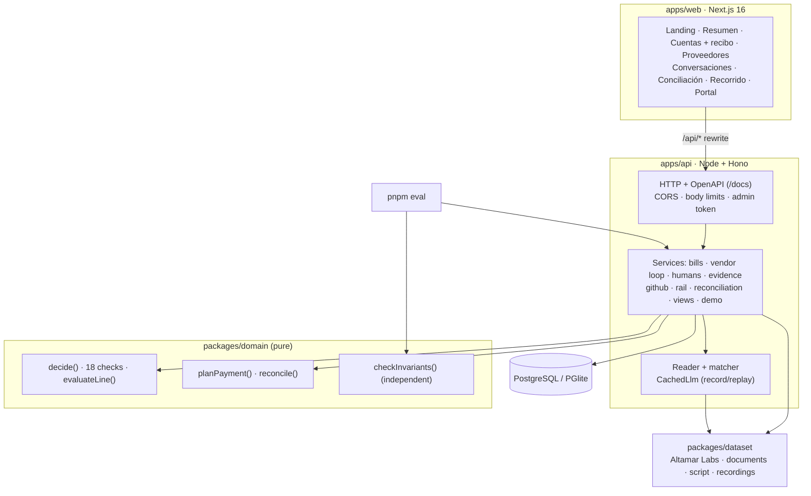
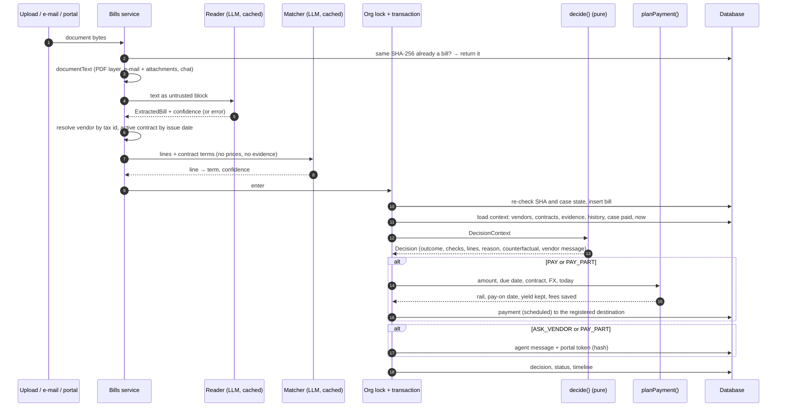
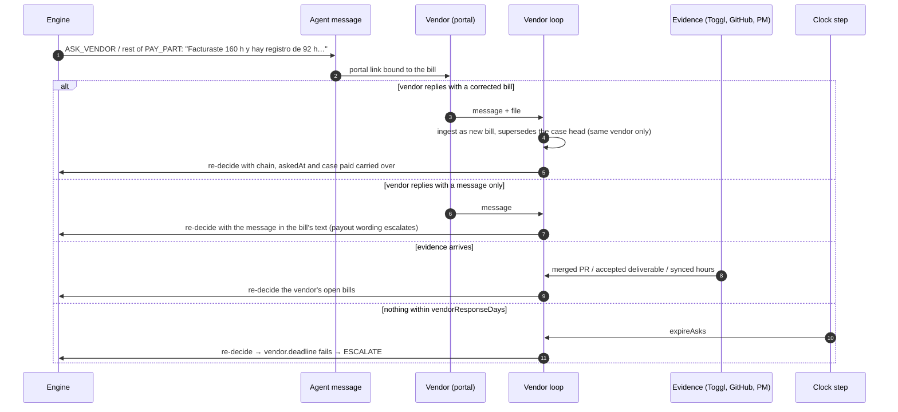
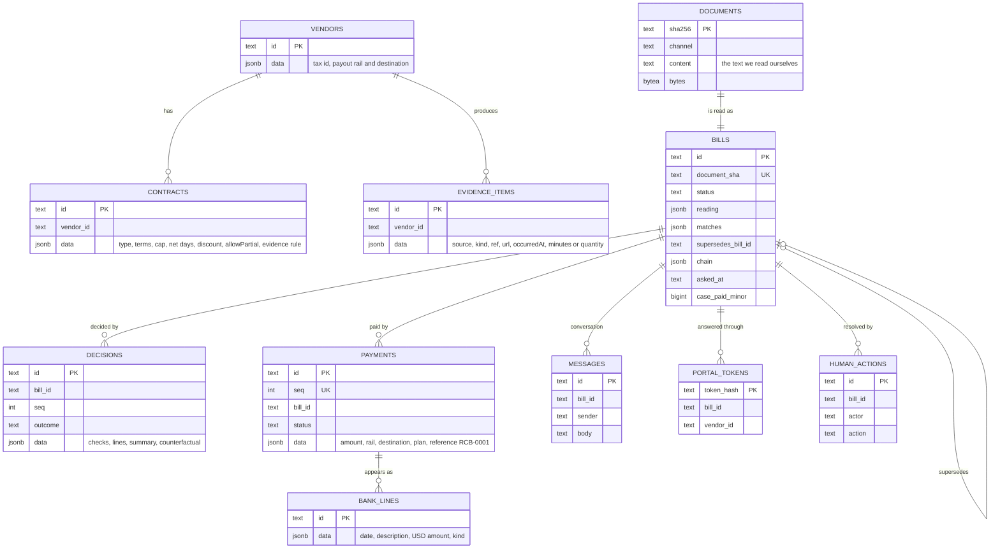
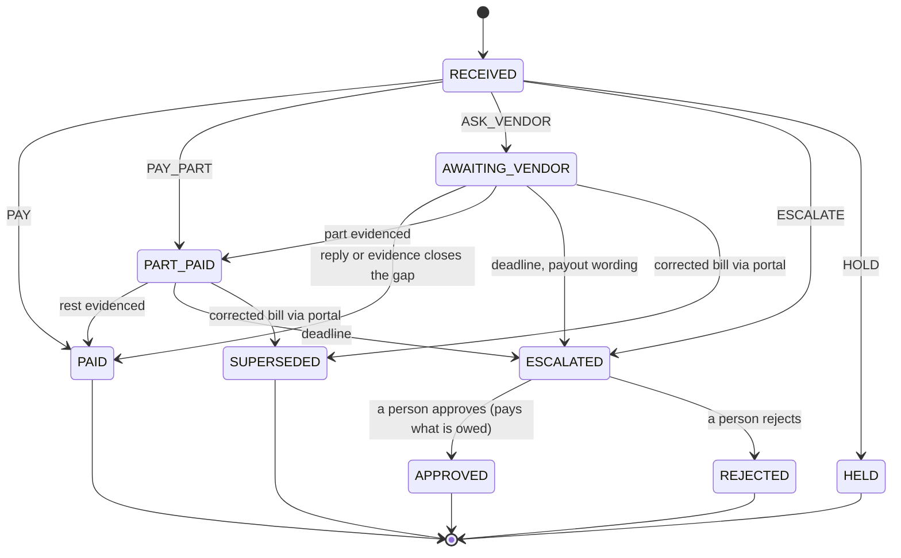

# System design

Recibido is an accounts-payable agent for services: it pays a bill only for the work it can prove
was delivered. This document covers the requirements, the containers and components, how a
decision is made, the vendor loop, the data model, the bill lifecycle, the invariants and how the
system fails. The approved product design is [PROPOSAL.md](PROPOSAL.md); the checks are in
[RULES.md](RULES.md).

## Requirements

### Functional

| #   | Requirement                                                                                                         | Where                                                                                                    |
| --- | ------------------------------------------------------------------------------------------------------------------- | -------------------------------------------------------------------------------------------------------- |
| F1  | Receive bills as PDF, e-mail (`.eml`, with attached PDFs) or chat text, and through the vendor portal.              | `POST /api/v1/bills`, [`documents.ts`](../apps/api/src/reading/documents.ts)                             |
| F2  | Read each bill into typed fields with confidence; map its lines to the contract's terms.                            | [`reader.ts`](../apps/api/src/reading/reader.ts), [`matcher.ts`](../apps/api/src/reading/matcher.ts)     |
| F3  | Run a three-way match (contract, evidence, bill) and decide one of five outcomes.                                   | [`engine.ts`](../packages/domain/src/engine.ts)                                                          |
| F4  | Ask the vendor for what is missing, re-decide on its reply or on new evidence, escalate on deadline.                | [`vendor-loop.ts`](../apps/api/src/services/vendor-loop.ts)                                              |
| F5  | Let a person approve or reject an escalated bill, with the exact reason.                                            | [`humans.ts`](../apps/api/src/services/humans.ts)                                                        |
| F6  | Plan each payment: rail by currency, date by due date vs. early-payment discount, yield and fees.                   | [`payments.ts`](../packages/domain/src/payments.ts)                                                      |
| F7  | Execute payments on a (simulated) rail and reconcile its bank statement line by line.                               | [`rail.ts`](../apps/api/src/services/rail.ts), [`reconcile.ts`](../packages/domain/src/reconcile.ts)     |
| F8  | A receipt per decision: reason, every check, evidence links, reading with confidence, counterfactual, payment plan. | [`explain.ts`](../packages/domain/src/explain.ts), [`views.ts`](../apps/api/src/services/views.ts)       |
| F9  | Take live evidence from GitHub (polling and signed webhook) and time entries from CSV.                              | [`github.ts`](../apps/api/src/services/github.ts), [`evidence.ts`](../apps/api/src/services/evidence.ts) |
| F10 | A guided demo with a one-click reset, and an eval over a labeled dataset that gates CI.                             | [`demo.ts`](../apps/api/src/services/demo.ts), [`eval.ts`](../apps/api/src/scripts/eval.ts)              |

### Non-functional

| Quality         | Target                                                                                                                                       |
| --------------- | -------------------------------------------------------------------------------------------------------------------------------------------- |
| Safety          | Zero improper payments; enforced by the engine and re-checked by an independent checker (I1–I7).                                             |
| Explainability  | Every decision explains itself in Spanish from its check trace; no model writes the reason.                                                  |
| Reproducibility | Same inputs, same decision; model answers recorded and replayed; simulated clock.                                                            |
| Operability     | Runs from a fresh clone with no keys and no database server; one container per app; PostgreSQL in production.                                |
| Cost            | Under USD 0.001 of model per bill (measured USD 0.00088).                                                                                    |
| Latency         | A decision in milliseconds once read (in our runs; not load-tested); a live GitHub merge pays within one poll (5 s) or instantly by webhook. |

## Context (C4 level 1)

## Containers (C4 level 2)

## Components

| Component             | Responsibility                                                                                                                                                            |
| --------------------- | ------------------------------------------------------------------------------------------------------------------------------------------------------------------------- |
| `documentText`        | Extracts the text we can read ourselves: PDF text layer, e-mail body plus its attached PDFs, chat transcript.                                                             |
| `BillReader`          | Prompts the model with the document as an untrusted block; JSON mode, zod-validated `ExtractedBill`, one retry on invalid JSON.                                           |
| `LineMatcher`         | Maps lines to term ids with confidence; sees no prices and no evidence.                                                                                                   |
| `CachedLlm`           | Replays recordings by key; calls the model on a miss when configured; writes when `RECORD=true`.                                                                          |
| `decide`              | Pure engine: resolves vendor and contract, evaluates every line's evidence, runs the 18 checks, aggregates, writes the reason, the counterfactual and the vendor message. |
| `planPayment`         | Rail by currency; date by due date vs. early-payment discount vs. yield; USD debit with the rail's spread; wire cost avoided.                                             |
| Bills service         | Ingests a document, decides it under the org lock, persists decision and payment, mints the portal token.                                                                 |
| Vendor loop           | Portal view and reply; corrected bills supersede through the token; `expireAsks` re-decides open asks on clock steps.                                                     |
| Humans                | Approve (pays what the case still owes, to the registered destination) or reject an escalation.                                                                           |
| Evidence              | Stores items, re-decides the vendor's open bills; deliverable acceptance; CSV time entries.                                                                               |
| `GithubEvidence`      | Polls tracked PRs; verifies webhook signatures; turns a merge into `pr_merged` evidence.                                                                                  |
| `SimulatedBlinkaRail` | Executes due payments into bank lines: debit with FX drift, fees, one return, one unexplained card line.                                                                  |
| Reconciliation        | `reconcile()` by reference token, then amount (± 1.5 %) and date (± 3 days); the view joins line ↔ payment ↔ bill ↔ contract ↔ evidence.                                  |
| Demo                  | Reset to October 1 (September lived through the real services), five tour actions, all through `runStep`.                                                                 |
| `checkInvariants`     | Re-derives I1–I7 over every payment with its own code; must not import the engine (a test reads its imports).                                                             |

## Decision pipeline

Reading and matching run before the lock because they are slow; everything that depends on other
bills runs inside it ([ADR-0015](adr/0015-serialized-decisions-per-organization.md)).

## Vendor loop

## Data model

Plus `timeline` (an append-only activity log) and `org_state` (the simulated clock and the demo
phase). Every table carries `org_id`. Schema: [`schema.ts`](../apps/api/src/db/schema.ts).

## Bill lifecycle

Only `AWAITING_VENDOR` and `PART_PAID` are re-decided automatically (`REOPENED`). A corrected bill
starts at `RECEIVED` with the case's chain, ask time and paid amount.

## The engine

`decide(ctx)` is the only place a payment is decided. It:

1. resolves the vendor by normalized tax id and the single contract valid on the issue date;
2. evaluates each line against the term the matcher chose and the vendor's evidence, in integer
   minor units ([RULES.md](RULES.md#details-that-matter));
3. runs the 18 checks; a blocking failure turns later checks into `not_run`;
4. takes the most severe outcome; computes `payNowMinor` (billed or evidenced, minus what the case
   already paid) and `askMinor`;
5. writes the Spanish summary, the counterfactual (the remedies of the failed checks) and, for an
   ask, the message to the vendor.

It has no I/O, no clock and no randomness; `ENGINE_VERSION` is stored with every decision.

## Invariants

The independent checker ([`checker.ts`](../packages/domain/src/checker.ts)) re-derives these over
every payment, with its own parsing and evidence code. Property tests
([`properties.test.ts`](../packages/domain/test/properties.test.ts)) generate random bills and
assert that every paying decision passes it; the eval runs it over both months.

| #   | Invariant                                                                                                                                |
| --- | ---------------------------------------------------------------------------------------------------------------------------------------- |
| I1  | Every payment goes to a registered vendor, the bill's own vendor, at its registered destination.                                         |
| I2  | Every agent payment follows a `PAY` or `PAY_PART` decision of the same amount on a known bill, in the contract's currency.               |
| I3  | When the agent pays, everything paid on the bill's chain so far is ≤ what this bill proves and ≤ what it bills.                          |
| I4  | Every line of a paid bill is a contract term at or below its price, and everything paid on the contract in a month is ≤ the monthly cap. |
| I5  | One invoice number of a vendor is paid on one chain only.                                                                                |
| I6  | Every amount is a safe positive integer in minor units.                                                                                  |
| I7  | Every agent payment is within the automatic payment limit.                                                                               |

Returned payments are excluded from the sums (that money came back). Person payments count toward
the sums but only the agent's are judged.

## Failure modes

| Failure                                                | Behavior                                                                                                       |
| ------------------------------------------------------ | -------------------------------------------------------------------------------------------------------------- |
| No model key and no recording                          | Reading fails → `reading.available` → ESCALATE ("no pudimos leer la cuenta").                                  |
| Model times out (120 s), returns invalid JSON, 401/402 | One retry for invalid JSON; then a Spanish error on the receipt and ESCALATE. Never a throw into the decision. |
| Empty document text                                    | The model is not called; the bill escalates as unreadable.                                                     |
| Low-confidence field or match                          | ESCALATE with the field and its confidence.                                                                    |
| Ambiguous vendor or two active contracts               | ESCALATE (`vendor.registered`, `contract.active`).                                                             |
| Missing FX rate                                        | `policy.limit` fails → ESCALATE.                                                                               |
| Same document uploaded twice                           | Same SHA-256 → the existing bill is returned; nothing new is decided.                                          |
| Two decisions at once                                  | Serialized by the org lock; state re-checked inside it.                                                        |
| Correction to a closed case                            | 409; nothing changes.                                                                                          |
| GitHub API 403/404/429; bad webhook signature          | Evidence unchanged; webhook 401.                                                                               |
| A stale recording after a prompt change                | Replay misses; CI fails naming the key.                                                                        |
| Unmatched or returned bank line                        | Flagged in reconciliation; the bill stays as it was decided.                                                   |

## Scalability

- **Per bill:** one reading and at most one matching (two model calls of a few seconds, recorded
  answers replay instantly); the engine took milliseconds in our runs.
- **Throughput:** the org lock serializes only the write and decide step, not the model calls, so one process should handle the expected volume (10,000 bills a month is about 330 a day); we have not load-tested it.
- **Horizontal scale:** replace the in-process lock with `pg_advisory_xact_lock(org)` (marked with
  a `ponytail:` comment in [`lock.ts`](../apps/api/src/services/lock.ts)); the rest is stateless.
- **Multi-entity:** every table already carries `org_id`; Blinka's customers with hundreds of
  entities would get one org each, decided independently.
- **History reads:** the decision context loads the organization's bills; at large volume it would
  load only the contract's and vendor's history, which is all the checks use.
