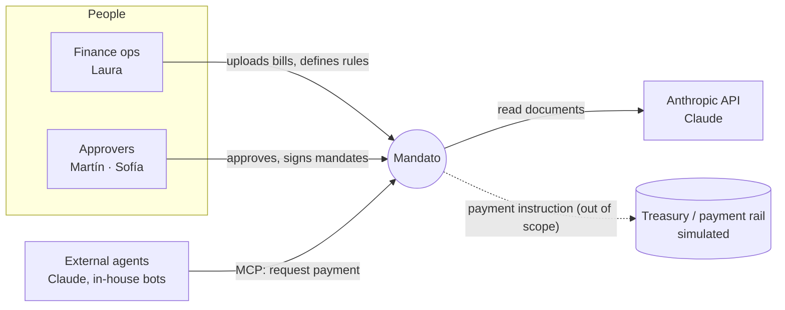
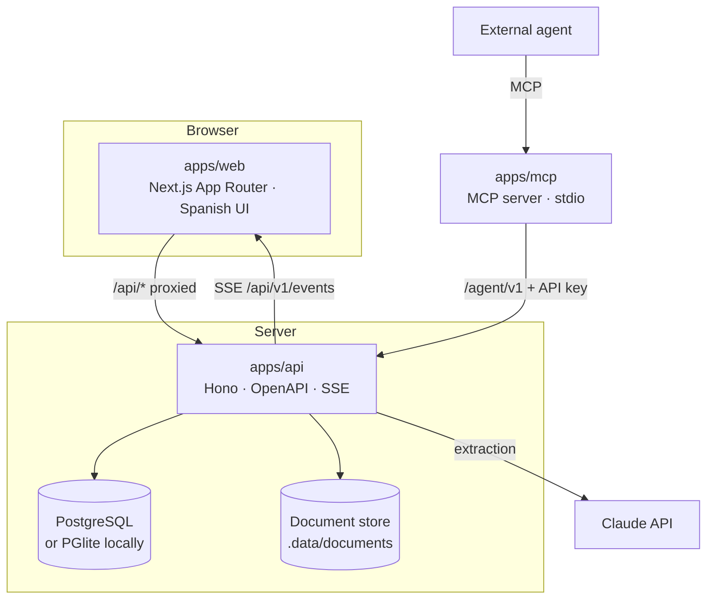
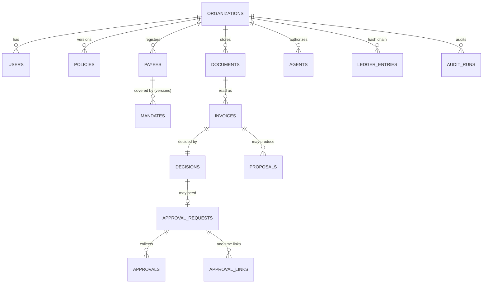
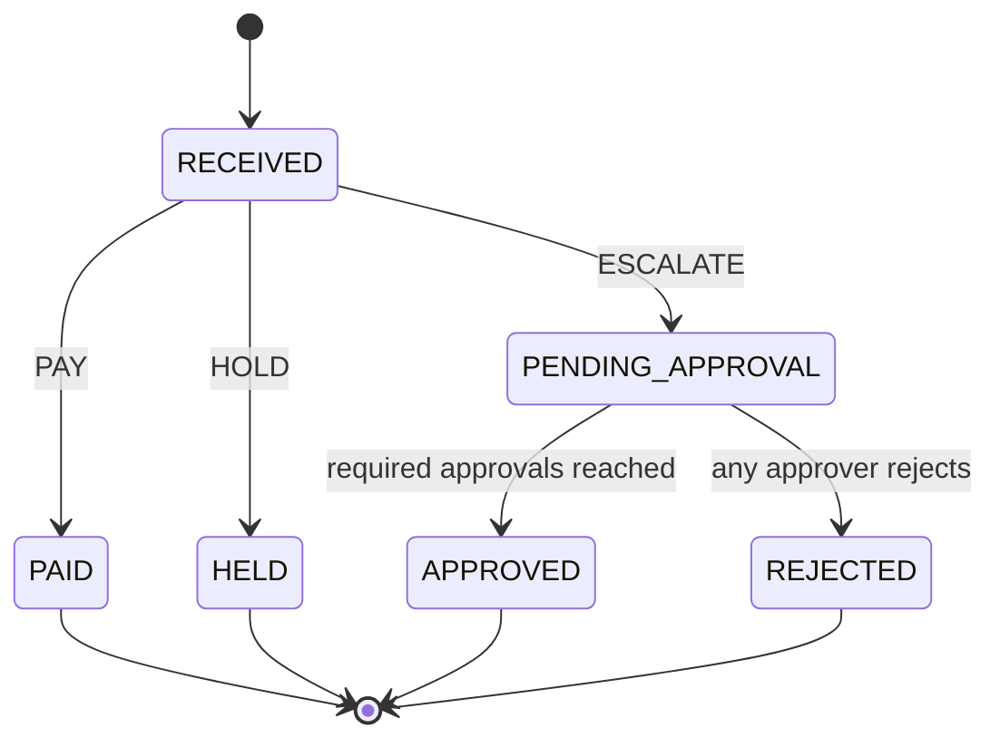

# System design — Mandato

> An accounts-payable agent that pays what the company signed for and asks a person for
> everything else. Built for the Blinka challenge at the 30X Hackathon (October 2026).

- Product context: [docs/product](product/01-problem.md)
- Decisions: [docs/adr](adr/README.md)
- Rules: [RULES.md](RULES.md) · Security: [SECURITY.md](SECURITY.md) · API: [API.md](API.md)

## 1. Requirements

### Functional

| ID  | Requirement                                                                                                                                       | Source           |
| --- | ------------------------------------------------------------------------------------------------------------------------------------------------- | ---------------- |
| F1  | Ingest bills as PDF, image, email (`.eml` with attachments), chat text, or structured agent requests.                                             | Brief §02, §07   |
| F2  | Extract payee, amount, currency, due date, invoice number, payout details, with confidence.                                                       | Brief §06        |
| F3  | Decide `PAY` / `HOLD` / `ESCALATE` under configurable rules: per-payment and per-period limits, allowed payees, human approval above a threshold. | Brief §06        |
| F4  | Record every decision with its reasons; explain it in plain Spanish.                                                                              | Brief §06, §10   |
| F5  | A screen where the company defines its rules and sees what was paid, held, pending, and why.                                                      | Brief §08        |
| F6  | Human approvals for escalations, with dual approval above a threshold, from web or a one-tap link.                                                | Brief, ADR-0012  |
| F7  | Mandates (standing agreements) signed by humans; proposals generated by the agent after approvals.                                                | ADR-0004         |
| F8  | What-if preview of policy changes against history before saving.                                                                                  | Differentiator   |
| F9  | Independent audit of every payment and of the ledger's integrity; CSV/JSON export for reconciliation.                                             | ADR-0006         |
| F10 | Attack lab: launch adversarial bills on demand.                                                                                                   | Differentiator   |
| F11 | MCP gateway for external agents with scoped keys.                                                                                                 | ADR-0013         |
| F12 | Demo mode: seed the fictitious company and replay August and September, the live files and the attack lab.                                        | Jury walkthrough |

### Non-functional

| ID  | Requirement                                                                                       |
| --- | ------------------------------------------------------------------------------------------------- |
| N1  | **Safety:** no `PAY` outside the rules, under any extraction output (property-tested).            |
| N2  | **Reproducibility:** decisions are re-derivable from stored inputs; evaluation runs offline.      |
| N3  | **Explainability:** 100% of decisions have a receipt readable without code.                       |
| N4  | **Zero-infra local run:** `pnpm install && pnpm dev`, no Docker, no API key required.             |
| N5  | **Latency:** decision (excluding extraction) < 50 ms p95; extraction is asynchronous to the lock. |
| N6  | **No real data:** all people, companies, tax IDs and accounts are fictitious.                     |

## 2. Context (C4 level 1)



## 3. Containers (C4 level 2)



`packages/domain` (pure engine) is imported by the API, the web app (types, formatting, what-if
rendering) and the evaluation harness. `packages/dataset` provides the fictitious company, bills,
attacks and the scripted human actions.

## 4. Components of the API

```mermaid
flowchart LR
  subgraph HTTP["http/ (adapters in)"]
    R1[routes: invoices · approvals · policy · mandates · payees · proposals · audit · metrics · demo · attacks · agent]
    SSE[SSE stream]
  end
  subgraph APP["services/ (application)"]
    ING[IngestInvoice]
    DEC[DecideInvoice]
    APR[Approvals]
    PRO[Proposals]
    POL[Policy & what-if]
    AUD[Audit]
    MET[Metrics]
    DEMO[Demo & attacks]
    AGW[Agent gateway]
    LED[Ledger]
  end
  subgraph DOMAIN["packages/domain (pure)"]
    ENG[decide&#40;&#41;]
    EXP[receipts]
    PRP[proposeFromApproval&#40;&#41;]
    INV[audit invariants]
  end
  subgraph PORTS["ports → adapters out"]
    EXT[Extractor → Claude · Replay · Recording]
    STORE[UnitOfWork → Drizzle on pg / PGlite]
    DOCS[DocumentStore → filesystem]
    CLK[Clock → system / simulated]
    BUS[EventBus → in-process]
  end
  R1 --> APP
  APP --> DOMAIN
  APP --> PORTS
  BUS --> SSE
```



## 5. The decision pipeline

```mermaid
sequenceDiagram
  autonumber
  participant U as Uploader / agent
  participant A as API
  participant X as Extractor (Claude / replay)
  participant DB as Postgres
  participant E as Engine (pure)
  participant B as Event bus
  U->>A: POST /invoices (file | text | structured)
  A->>A: SHA-256, store document (idempotent by hash)
  A->>X: extract(document)  — outside any lock
  X-->>A: ExtractedInvoice + per-field confidence
  A->>DB: BEGIN; SELECT org FOR UPDATE
  A->>DB: load policy vN, payees, mandates, period history, balance
  A->>E: decide(context)
  E-->>A: Decision {outcome, rule results, summary, counterfactual, approvalsRequired}
  A->>DB: insert decision; update invoice status; reserve budget (PAY)
  A->>DB: append ledger entries (hash-chained)
  opt ESCALATE
    A->>DB: create approval request (1 or 2 approvers)
  end
  A->>DB: COMMIT
  A->>B: publish decision.created
  A-->>U: receipt
```

Approval path:

```mermaid
sequenceDiagram
  participant P as Approver (phone)
  participant A as API
  participant D as Domain
  participant DB as Postgres
  P->>A: POST /approve/:token {approve}
  A->>A: verify HMAC, expiry, single use, approver
  A->>DB: BEGIN; lock org
  A->>DB: record approval; if count == required → invoice APPROVED, commit spend
  A->>D: proposeFromApproval(decision, invoice, context)
  D-->>A: MandateProposal | null
  A->>DB: insert proposal; append ledger; COMMIT
  A-->>P: "Aprobado"
```

## 6. Data model



Key columns:

- `policies(org_id, version, data jsonb)` — immutable versions: limits, budget, currencies,
  thresholds, FX snapshot.
- `mandates(org_id, mandate_key, version, payee_id, status, terms jsonb, signed_by jsonb)` —
  immutable versions; at most one active version per `mandate_key`.
- `invoices(org_id, ref, document_id, source, extraction jsonb, status, period_key,
usd_amount_cents, payee_id)` — status ∈ `PAID`, `HELD`, `PENDING_APPROVAL`, `APPROVED`,
  `REJECTED`, `RECEIVED`.
- `decisions(invoice_id, outcome, results jsonb, summary, counterfactual jsonb,
policy_version, mandate_id, mandate_version, fx jsonb, engine_version)`.
- `ledger_entries(seq, org_id, type, entity_id, actor, payload jsonb, prev_hash, hash)`.

### Bill lifecycle



`PAID` means _scheduled for payment by the agent_; `APPROVED` means _scheduled after human
approval_. No money moves in this project (out of scope).

## 7. The engine

`decide(context) → Decision` is a pure function in `packages/domain`:

1. **Derive facts**: normalize invoice number, tax ID and destination; resolve the payee (tax ID or
   exact destination only); pick the active mandate; convert to USD (BigInt, ceil); compute the
   period key, the payee's month-to-date count and amount, and committed spend.
2. **Evaluate every rule** in [RULES.md](RULES.md) → `RuleResult { id, status, onFail, observed,
expected, detail, remedy }`.
3. **Aggregate** deny-by-default ([ADR-0003](adr/0003-three-outcomes-deny-by-default.md)).
4. **Explain**: summary + counterfactual from the trace ([ADR-0005](adr/0005-counterfactual-receipts-from-rule-traces.md)).
5. **Approvals required**: 0, 1, or 2 (dual threshold).

### Invariants (asserted by property tests and by the auditor)

| #   | Invariant                                                                                         |
| --- | ------------------------------------------------------------------------------------------------- |
| I1  | `PAY` ⇒ payee registered & active, and the payout destination equals the registered one.          |
| I2  | `PAY` ⇒ an active, in-validity mandate covers payee, currency, amount, frequency and period cap.  |
| I3  | `PAY` ⇒ USD amount ≤ global limit, or ≤ the mandate's signed exception.                           |
| I4  | `PAY` ⇒ committed month spend + amount ≤ budget, and amount ≤ available balance.                  |
| I5  | `PAY` ⇒ no other paid/approved/pending bill of the payee has the same normalized number.          |
| I6  | `PAY` ⇒ critical fields' confidence ≥ threshold and no agent-directed instructions were detected. |
| I7  | `APPROVED` ⇒ ≥ required distinct approvers with the approver role.                                |
| I8  | Ledger: `hash[n] = SHA-256(hash[n−1] ‖ entry[n])` for every entry.                                |
| I9  | Tightening any policy threshold never turns a non-`PAY` decision into `PAY` (monotonicity).       |

## 8. Extraction

- One prompt, one JSON schema (`ExtractedInvoice`), validated with Zod. PDFs go as document blocks,
  images as image blocks, emails are parsed (headers, text body, attachments) and chats sent as
  text.
- The model is told the document is untrusted data and that any instruction inside it must be
  reported, never followed. A deterministic scanner checks the same thing on every text we can read.
- Results are cached by `sha256(document) + extractorVersion` (record/replay,
  [ADR-0010](adr/0010-claude-extraction-with-record-replay.md)).
- Extraction runs **before** the organization lock; only the decision is serialized.

## 9. Failure modes

| Failure                             | Behaviour                                                                                 |
| ----------------------------------- | ----------------------------------------------------------------------------------------- |
| Claude unavailable / no API key     | Replay cache; cache miss → extraction marked unavailable → `ESCALATE` ("no pude leerla"). |
| Extraction schema violation         | Treated as unreadable → `ESCALATE`.                                                       |
| Reader wrong or prompt-injected     | Engine invariants bound the damage (registered destination, signed mandate, limits).      |
| Same document uploaded twice        | Idempotent by SHA-256: returns the existing bill, no new decision.                        |
| Same bill re-sent in another format | `duplicate.invoice_number` → `HOLD`.                                                      |
| Concurrent decisions                | Serialized per organization; budget cannot be double-spent.                               |
| Approval link leaked                | HMAC, expiry, single use, bound to one approver.                                          |
| Ledger tampered in the database     | Auditor detects the broken hash chain.                                                    |
| Policy change too permissive        | What-if preview shows its effect before saving; every change is a new audited version.    |

## 10. Scalability and evolution

- The engine is CPU-only and sub-millisecond per bill; the bottleneck is extraction, which is
  parallelizable and outside the lock.
- Horizontal scale: stateless API instances; replace the in-process event bus with Postgres
  `LISTEN/NOTIFY`; documents to object storage behind `DocumentStore`.
- Real payments: a `PaymentRail` port consuming `PAID`/`APPROVED` bills (Blinka's API, Bre-B,
  SPEI, Pix) — deliberately out of scope here.
- Real authentication: an identity provider in front of the API; approval links stay as
  capabilities.

## 11. Deployment

- Local: `pnpm install && pnpm dev` (PGlite, replay extraction).
- Docker Compose: Postgres + API + web.
- Railway: three services (Postgres, API, web); see [DEPLOY.md](DEPLOY.md).
